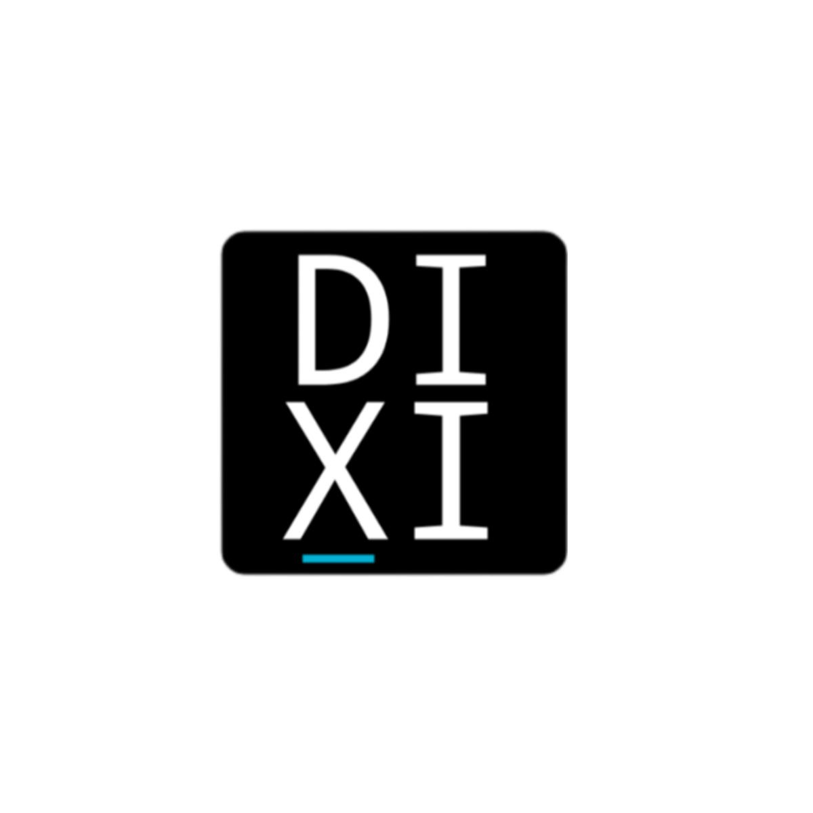

# About DixiOS 
## Logo

## Description 

DixiOS is A Modular & x86_32 OS Based on 
- HTML
- CSS
- JS
- JAVA
- BASH
- C
- PowerShell For Build DixiOS In Windows && MARKDOWN For Write Docs
- He Depends On Linux Kernel 6.18.40 LTS

And Runs In Limbo X86 Emulator ( core2duo )
## History 

 [History](https://github.com/BrCraft131313/DixiOS/blob/Home/Docs/ChangeLog.md)

 ## User Guide 

 [User Guide](https://github.com/BrCraft131313/DixiOS/blob/Home/Docs/UserGuide/UserGuide.md)

## Build Scripts

There are two files that start with the same name, but in different programming languages.

Some of you may be wondering: Why?

Firstly, If the HostOS is from the UNIX family, Use build.sh/build-lite.sh ( BASH )

If The HostOS is Windows And The Your Windows Support PowerShell, Use build.ps1/build-lite.ps1 ( PowerShell )

And some of you are also wondering: why you don't use Makefile ( Cmake )

The Answer is: Why build something in a language I haven't learned, when the two previous languages are sufficient?

### The formats supported by the four files ( build.sh && build.ps1 && build-lite.sh && build-lite.ps1 )

#### All Scripts Support This Formats

- IMG
- ISO
- TARXZ

  #### Only build.sh && build.ps1 Support This Formats 

- JAR ( BRIDGE )
- ALL

## End of general introduction to the DixiOS 

DixiOS, From an idea in my head and a challenge, to a reality I see with my own eyes

You don't need a goal to build something you enjoy as a hobby.

You can set reasons or goals, but your project cannot be useless simply because you didn't set goals for it.

Greetings to everyone who has used DixiOS or read the documentation.

BrCraft131313,

## Related projects

