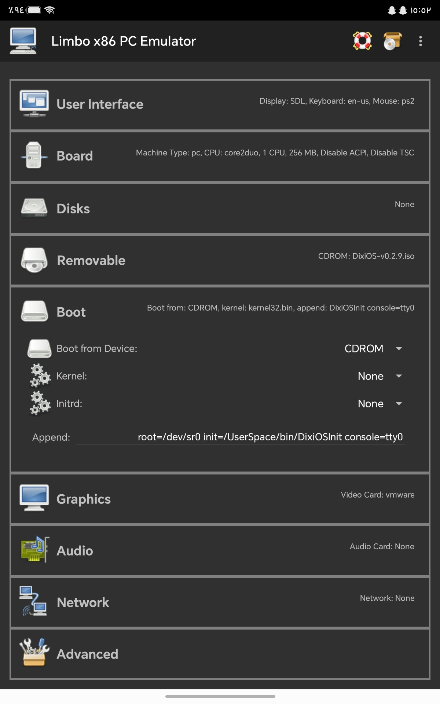

# Guide

## Install VM & OS

First: Download The [VM](https://github.com/limboemu/limbo/releases/download/v6.0.1-LimboEmulator/limbo-android-x86-6.0.1-qemu-5.1.0.apk)

Then: Download The [OS](https://github.com/BrCraft131313/DixiOS/releases)

Then: Download The [Kernel](https://github.com/BrCraft131313/DixiOS/blob/Home/boot/kernel32.bin)

Then: Create A New Machine

Then: Follow the image 

Note: If You Use DixiOS v0.1, Replace DixiOSInit To sh

ex: init=/UserSpace/bin/sh

Then Enjoy With OS!

## Use The OS & Commands

Type help to see Available Commands

Type help cmd to explain the command

### DXS
The Syntax of DXS is

[help, print f] if You Use 0.2.5+

[name: h, help, print f] if You Use 0.2.4

[name: h, help] if You Use 0.2.3